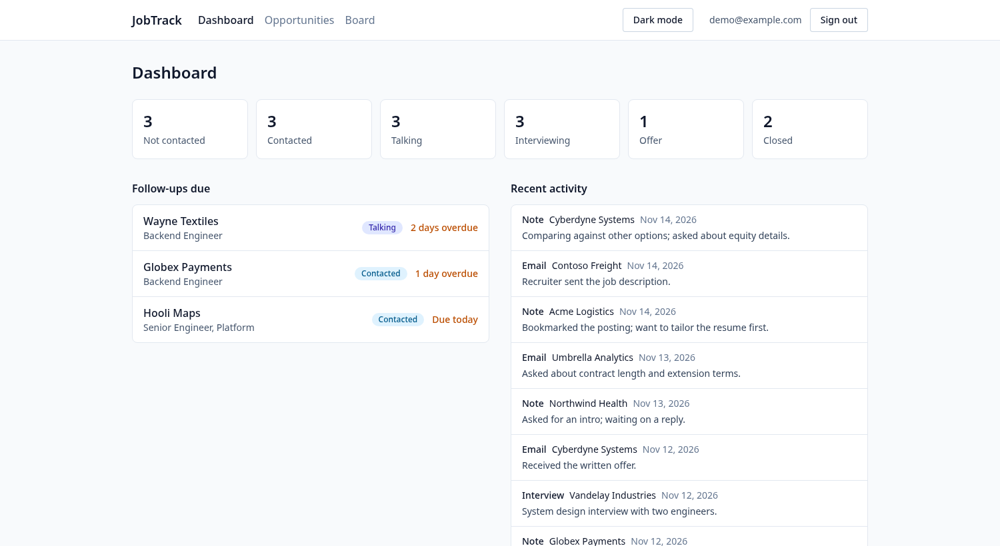

# JobTrack

A small Rails 8 + React + TypeScript app for tracking a job search: a dashboard, a filterable list, a drag-and-drop status board, and a timeline of activity for each opportunity.


## Why it exists

It's a real tool I wanted for my own search, and a compact place to show Rails 8 and React/TypeScript working together. Rails still owns routing, auth, validations and the database. React replaces only the view layer, through Inertia, so there is no separate API to build and keep in sync.



## Stack

| Layer | Choice |
|---|---|
| Back end | Rails 8.1, Ruby 3.4, PostgreSQL, Rails' built-in authentication (single user) |
| Front end | React 19, TypeScript (strict, no `any`), function components and hooks |
| Glue | `inertia_rails` + `@inertiajs/react`, `vite_rails` |
| Styling | Tailwind CSS 4, with a light/dark theme |
| Drag and drop | `@dnd-kit/core` |
| Ruby tests | RSpec (model and request specs), FactoryBot |
| JS tests | Vitest + React Testing Library |
| Lint and types | RuboCop (rails-omakase), ESLint (type-aware), Prettier, `tsc --noEmit`, Brakeman, bundler-audit |
| CI | GitHub Actions |

## Running locally

You need Ruby 3.4, Node 22 (versions are in `.tool-versions`, so [mise](https://mise.jdx.dev) can install both) and a PostgreSQL server. The defaults expect user `postgres`, password `postgres` on `localhost`; override with `DATABASE_HOST`, `DATABASE_USER` and `DATABASE_PASSWORD`. For example, with Docker:

```sh
docker run -d --name jobtrack-postgres -e POSTGRES_PASSWORD=postgres \
  -p 127.0.0.1:5432:5432 postgres:17
```

Then:

```sh
bin/setup --skip-server   # installs gems and packages, creates and seeds the database
bin/dev                   # Rails + Vite on http://localhost:3000
```

Sign in with the seeded demo account: `demo@example.com` / `password`. The seed data is entirely fictional (made-up companies, `example.com` URLs). If port 3000 is busy, use `PORT=3100 bin/dev`.

## Tests and CI

```sh
bin/rspec            # Ruby specs
npm test             # Vitest
npm run typecheck    # tsc --noEmit
npm run lint         # ESLint
bin/ci               # everything CI runs, locally
```

GitHub Actions runs RuboCop, Brakeman, bundler-audit, RSpec against a Postgres service, ESLint, Prettier, `tsc` and Vitest on every pull request.

## Design notes

**Inertia over a separate SPA.** A controller renders `render inertia: "Opportunities/Show", props: {...}` and that hash is the React page's props. Sessions, CSRF, flash messages, redirects and validations stay ordinary Rails. The cost is that React is coupled to Rails; a mobile client would need a real API. `app/frontend/types.ts` pins down each page's props, and request specs assert the same shapes.

**Filters live in the URL.** The opportunities list keeps its search, status, type and sort in the query string. Each change is a normal GET that Rails answers with fresh props, so links are shareable, a reload keeps the filters, and there is no client-side filtering logic to keep in step with the server. The search box is debounced.

**Optimistic drag and drop.** On the board, dropping a card updates the columns immediately and sends `PATCH /opportunities/:id/move`. The move logic is pure functions (`app/frontend/lib/board.ts`) with their own tests. If the server rejects the move, or the request fails, the card goes back and a message explains. A single check in the request's `onFinish` covers every failure. Fresh props from Rails always replace the local state. Dragging works with the keyboard too (Space to pick up, arrows to jump between cards and columns).

**Forms.** One `OpportunityForm` serves new and edit with Inertia's `useForm`. Required fields are checked in the browser for instant feedback, and Rails' validation errors come back per field and render next to the right input through a small accessible `Field` component. The server is the authority.

**Rails enums.** Status, kind, source and pay unit are string-backed enums with `validate: true`, so a bad value is a normal validation error rather than an exception.

## Roadmap

Not built yet: a daily Solid Queue job that flags follow-ups as due, a JSON API with token auth, and a Kamal deployment (with SQLite, so no separate database server).

## How it was built

This was built with AI assistance: agents drafted each task in its own git worktree and branch, one pull request per task, each with tests. I scoped the work, reviewed every pull request, ran each change in a real browser, and can explain the decisions in it. The commit and pull request history shows the sequence.
