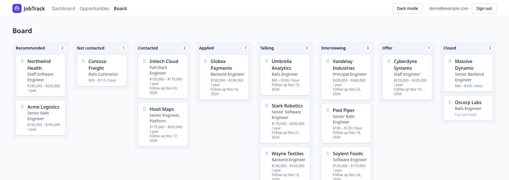
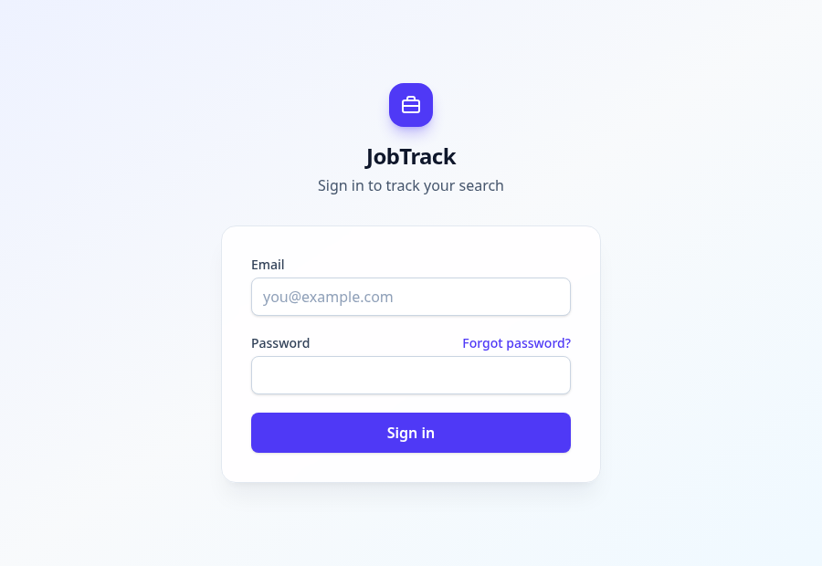

<p align="center"></p>

<h1 align="center">JobTrack</h1>

A small Rails 8 + React + TypeScript app for tracking a job search: a dashboard, a filterable list, a drag-and-drop status board, and a timeline of activity for each opportunity.



## Why it exists

It's a real tool I wanted for my own search, and a compact place to show Rails 8 and React/TypeScript working together. Rails still owns routing, auth, validations and the database. React replaces only the view layer, through Inertia, so there is no separate API to build and keep in sync.


## Stack

| Layer | Choice |
|---|---|
| Back end | Rails 8.1, Ruby 3.4, SQLite, Rails' built-in authentication (single user) |
| Front end | React 19, TypeScript (strict, no `any`), function components and hooks |
| Glue | `inertia_rails` + `@inertiajs/react`, `vite_rails` |
| Styling | Tailwind CSS 4, with a light/dark theme |
| Drag and drop | `@dnd-kit/core` |
| Ruby tests | RSpec (model and request specs), FactoryBot |
| JS tests | Vitest + React Testing Library |
| Lint and types | RuboCop (rails-omakase), ESLint (type-aware), Prettier, `tsc --noEmit`, Brakeman, bundler-audit |
| Background jobs | Solid Queue (database-backed, no Redis) |
| CI and deploy | GitHub Actions; Kamal to a single server |

## Running locally

You need Ruby 3.4 and Node 22 (versions are in `.tool-versions`, so [mise](https://mise.jdx.dev) can install both). There is no database server to run: SQLite files live in `storage/`.

```sh
bin/setup --skip-server   # installs gems and packages, creates and seeds the database
bin/dev                   # Rails + Vite on http://localhost:3000
```

Sign in with the seeded demo account: `demo@example.com` / `password`. The seed data is entirely fictional (made-up companies, `example.com` URLs). If port 3000 is busy, use `PORT=3100 bin/dev`.



Everything except sign-in requires an account, so there is no public live demo. The screenshots above show the app with the seeded fictional data.

## Tests and CI

```sh
bin/rspec            # Ruby specs
npm test             # Vitest
npm run typecheck    # tsc --noEmit
npm run lint         # ESLint
bin/ci               # everything CI runs, locally
```

GitHub Actions runs RuboCop, Brakeman, bundler-audit, RSpec, ESLint, Prettier, `tsc` and Vitest on every pull request.

## Design notes

**Inertia over a separate SPA.** A controller renders `render inertia: "Opportunities/Show", props: {...}` and that hash is the React page's props. Sessions, CSRF, flash messages, redirects and validations stay ordinary Rails. The cost is that React is coupled to Rails; a mobile client would need a real API. `app/frontend/types.ts` pins down each page's props, and request specs assert the same shapes.

**Filters live in the URL.** The opportunities list keeps its search, status, type and sort in the query string. Each change is a normal GET that Rails answers with fresh props, so links are shareable, a reload keeps the filters, and there is no client-side filtering logic to keep in step with the server. The search box is debounced.

**Optimistic drag and drop.** On the board, dropping a card updates the columns immediately and sends `PATCH /opportunities/:id/move`. The move logic is pure functions (`app/frontend/lib/board.ts`) with their own tests. If the server rejects the move, or the request fails, the card goes back and a message explains. A single check in the request's `onFinish` covers every failure. Fresh props from Rails always replace the local state. Dragging works with the keyboard too (Space to pick up, arrows to jump between cards and columns).

**Forms.** One `OpportunityForm` serves new and edit with Inertia's `useForm`. Required fields are checked in the browser for instant feedback, and Rails' validation errors come back per field and render next to the right input through a small accessible `Field` component. The server is the authority.

**Open pages refresh themselves.** Changes made through the MCP server or another tab reach the database but not a page that is already open, because Inertia pages only show the props they loaded. The dashboard, list, detail and board pages therefore re-fetch their props every 15 seconds (`useAutoRefresh`), and only while the tab is visible; coming back to a tab refreshes it at once. It is polling, not websockets: one user, one small query set, no extra infrastructure. The board pauses while a card is being dragged or saved so fresh props never replace its columns mid-move, a poll never cancels a navigation or wipes a flash message, and a failed poll is ignored rather than raising an error modal. The form pages do not poll.

**A recurring job for time-based state.** An opportunity becomes "due" when its follow-up date arrives, which is not an edit, so nothing in a request would notice. A stored `due` flag keeps the dashboard to one indexed query. A `before_save` callback keeps it right when you edit a record, and `FollowUpReminderJob` (Solid Queue, declared in `config/recurring.yml`, 7am Eastern) rolls it over each morning, turning it on for newly due records and off for any that no longer qualify. The rule lives in one scope, `Opportunity.follow_up_due`, and specs check the callback and the job agree with it. Solid Queue is database-backed, so there is no Redis. In development nothing runs the scheduler; run `bin/rails runner FollowUpReminderJob.perform_now` to refresh the flags by hand.

**SQLite in production.** This is a single-user app, so SQLite is a good fit and removes a moving part: Rails 8 runs the app, Solid Queue (jobs), Solid Cache and Solid Cable each in their own SQLite file on one persistent volume. The one place the model had to care was search: it uses Arel's `matches` (a case-insensitive `LIKE` with explicit escaping) rather than Postgres-only `ILIKE`. Development, CI and production all use the same database, so there is no "works on my Postgres" gap. The trade-offs are one writer at a time and one server; neither matters here.

**Pipeline stages.** Eight statuses run left to right: recommended (a good match not yet acted on), not contacted, contacted, applied (sent, no reply yet), talking, interviewing, offer, closed. A closed opportunity can carry a reason (rejected, withdrew, posting closed, created by mistake, other), which is cleared if it is reopened. Archiving hides a record everywhere without deleting it.

**Duplicates.** `external_id` (the job board's own id) is unique when present, and a posting URL can only be tracked once, compared ignoring host case, a trailing slash and a `#fragment`. The model enforces both, so the web form, the JSON API and MCP all refuse a repeat. The MCP tools check first, so the assistant gets a message naming the existing record (and saying if it is archived) rather than a bare validation error. `last_verified_on` records when a posting was last confirmed live; `stale_postings` lists the ones that need re-checking.

**Application details.** Optional fields record where an application went (`application_channel`: email, company form, hiring platform, referral, other), which resume was sent and who the contact is. The MCP server tells the assistant to use them, and the pay fields, rather than the free-text notes.

**Rails enums.** Status, kind, source, pay unit and closed reason are string-backed enums with `validate: true`, so a bad value is a normal validation error rather than an exception.

## JSON API

The web UI is Inertia, so it has no public API. A small token-authenticated one lives under `/api/v1/opportunities` for scripts and other clients: list (`q`, `status`, `kind`, `dir` filters, and `archived=true` to include archived records), show, create and update, with the same fields and validations as the form.

```sh
bin/rails 'api_tokens:create[you@example.com,laptop]'   # prints a token once
curl -H "Authorization: Bearer $TOKEN" https://your.host/api/v1/opportunities?status=talking
curl -X POST -H "Authorization: Bearer $TOKEN" -H "Content-Type: application/json" \
  -d '{"opportunity":{"company":"Acme Logistics","role":"Rails Engineer"}}' https://your.host/api/v1/opportunities
```

Errors are JSON: 401 for a missing or wrong token, 404 for an unknown id, 422 with `{"errors": {"field": ["message"]}}` for invalid data, 400 for a body without `opportunity`.

**Design notes.** The API controllers inherit from `ActionController::API`, so there are no cookies, sessions or CSRF to reason about, and a browser session does not authenticate an API call. Only a SHA-256 digest of each token is stored (tokens are long random strings, so a slow password hash is unnecessary and the indexed lookup stays cheap), and the plaintext is shown once when issued. Requests are rate limited to 120 a minute. The editable fields come from one constant, `Opportunity::EDITABLE_ATTRIBUTES`, shared with the web form, so the two cannot drift. There is no delete, archive, pagination or board-move endpoint yet, because the app has none of those in the UI either.

## Connecting an AI assistant (MCP)

The app is also an [MCP](https://modelcontextprotocol.io) server at `/mcp`, so an assistant that supports MCP (such as Open WebUI) can search and update your job search directly, with no copy and paste. It uses the same API tokens as the JSON API, over the same container and port.

```sh
bin/rails 'api_tokens:create[you@example.com,assistant]'   # prints a token once
```

Point the assistant at `http://<your-host>:3200/mcp` (transport "streamable HTTP") and send the token as `Authorization: Bearer <token>`. In Open WebUI that is Admin Settings, External Tools, add a server of type MCP (streamable HTTP); older versions need the `mcpo` proxy.

| Tool | What it does |
|---|---|
| `search_opportunities` | List opportunities, filtered by text, status or kind (archived ones only with `include_archived`) |
| `get_opportunity` | One opportunity with its full activity history |
| `follow_ups_due` | Open opportunities whose follow-up is today or overdue |
| `pipeline_summary` | Counts per status, and how many follow-ups are due |
| `create_opportunity` | Add an opportunity; a repeated posting ID or URL is reported as a duplicate, not added |
| `bulk_create_opportunities` | Add up to 25 at once (a daily search, say); each item is created, skipped as a duplicate, or reported as an error on its own |
| `update_opportunity` | Change fields; a status change moves the card to the bottom of its column |
| `stale_postings` | Postings not confirmed live within N days, so they can be re-checked |
| `archive_opportunity` | Hide an entry made by mistake, or restore it. Nothing is deleted |
| `log_activity` | Record an email, call, interview or note |

**Design notes.** It is a small Rack app (`JobTrackMcp::Endpoint`) built on the official Ruby SDK and mounted in the Rails routes, so there is nothing extra to deploy. It is stateless, so each request stands alone and a restart strands no one. The tools call the same models as the web app, with the same validations, so the assistant cannot save anything the form would reject; bad input comes back as a readable tool error. Dates are checked rather than silently dropped. Read-only tools are annotated as such so a client can allow them without prompting. There is deliberately no delete tool: a mistaken entry is archived (hidden from the board, list, counts and reminders, and reversible), and a real job that ended is closed with a reason. The server tells the model to treat text in opportunities as data, not instructions, since job postings and emails are untrusted text that could try to steer an assistant. Anyone with a token can read and change your data, so keep it private and revoke it by deleting its row in the console (`ApiToken.find_by(name: "assistant").destroy`).

## How it was built

This was built with AI assistance: agents drafted each task in its own git worktree and branch, one pull request per task, each with tests. I scoped the work, reviewed every pull request, ran each change in a real browser, and can explain the decisions in it. The commit and pull request history shows the sequence.

## Deploying

The app deploys to a single server with [Kamal](https://kamal-deploy.org) (Docker, with automatic HTTPS from Let's Encrypt). You need a Linux server you can SSH into as root, a domain name pointing at it, Docker on your machine, and a GitHub token with the `write:packages` scope (images go to `ghcr.io`).

```sh
export DEPLOY_SERVER_IP=203.0.113.10        # your server
export DEPLOY_HOST=jobtrack.example.com     # your domain
export KAMAL_REGISTRY_PASSWORD=ghp_...      # GitHub token, write:packages

bin/kamal setup                             # first time: installs Docker, boots the app
bin/kamal app exec -i "bin/rails 'users:create[you@example.com]'"   # prompts for a password
```

Later deploys are `bin/kamal deploy`. Notes:

- Demo seed data is never loaded in production, and no default login exists; the only user is the one you create.
- The database lives on a Docker volume (`jobtrack_storage`), so it survives deploys. Back it up with `bin/kamal app exec "sqlite3 storage/production.sqlite3 .dump"` or by copying the volume.
- The job queue runs inside the web process (`SOLID_QUEUE_IN_PUMA`), which is where the daily 7am follow-up job runs.
- `bin/kamal logs` and `bin/kamal console` are shortcuts defined in `config/deploy.yml`.

## Running in a container

For personal use, the simplest setup is one container on a machine you own (a home server, a NAS), with the data on a volume. Nothing is exposed to the internet and there is no domain or certificate to manage. The image is built by the `Publish image` workflow from each tagged release and pulled from `ghcr.io/chernesk/jobtrack`.

```sh
docker compose up -d                         # http://localhost:3200
docker compose exec jobtrack bin/rails 'users:create[you@example.com]'   # prompts for a password
```

To build from a checkout instead of pulling: `docker compose -f compose.yaml -f compose.build.yaml up -d --build`.

**TrueNAS (24.10 or later).** In Apps, choose Discover Apps, then Custom App, then Install via YAML, and paste `compose.yaml` as it is (change the port if 3200 is taken). There is nothing to configure. Open a shell on the app (Apps, the app's workloads, Shell) to run the `users:create` command above. To keep the data in a dataset you control, replace the named volume with a host path such as `/mnt/<pool>/apps/jobtrack:/rails/storage`, and give it to the container's user first: `chown 1000:1000 /mnt/<pool>/apps/jobtrack`. The package is private by default; either make it public in the repository's package settings (simplest) or give the host a `ghcr.io` login with a GitHub token that has `read:packages`.

**Follow-up notifications (optional).** The 7am job that flags due follow-ups can also push one notification to your phone through [ntfy](https://ntfy.sh), listing everything due, overdue included ("Acme, Engineer (3 days overdue)"). On a day with nothing due it sends a quiet "No follow-ups due" message instead, so you know the check ran. A failed send never fails the job, and the job logs one line saying what it did. It is off until you set a topic:

| Variable | Meaning |
| --- | --- |
| `NTFY_TOPIC` | Required to turn it on. Use a long, hard-to-guess name: on ntfy.sh anyone who knows a topic can read it. |
| `NTFY_URL` | Your ntfy server. Defaults to `https://ntfy.sh`; set it for a self-hosted one. |
| `NTFY_TOKEN` | Optional access token for a protected topic. |
| `APP_URL` | Optional. Tapping the notification opens this address (for example `http://nas.local:3200`). |
| `NTFY_HIDE_NAMES` | Optional. Any value sends only "N follow-ups due" with no company names, for a public topic. |

Add them under `environment:` in `compose.yaml`. To try it without waiting for 7am: `docker compose exec jobtrack bin/rails runner FollowUpReminderJob.perform_now`.

Notes:

- The container serves plain HTTP (`FORCE_SSL=false`), so keep it on your home network. To reach it from outside, put a reverse proxy that terminates HTTPS in front and remove that setting.
- All state is in `/rails/storage` (the app, queue, cache and cable SQLite files). The app creates its signing secret on first start and keeps it there as `secret_key_base` (mode 600), so keep that file with your backups; losing it only signs you out. To use your own instead, set a `SECRET_KEY_BASE` environment variable (`openssl rand -hex 64`); Kamal deploys keep using the encrypted credentials.
- Back up by copying that directory while the container is stopped, or with `docker compose exec jobtrack sqlite3 storage/production.sqlite3 ".backup storage/backup.sqlite3"`.
- To upgrade, change the version in the `image:` line of `compose.yaml` (see the [releases](https://github.com/chernesk/jobtrack/releases)) and redeploy; to go back, change it back. Pinning a version matters on a NAS: a host that already has `latest` will not re-pull it. The entrypoint runs `db:prepare`, so migrations apply on start.
- Your real data lives only in that volume. Never commit it; the repo's seeds are fictional on purpose, and they never load in production.

## Releasing

A release is a version tag. Use plain rules: a patch (`1.0.1`) for fixes, a minor (`1.1.0`) for features.

```sh
git tag -a v1.0.1 -m "Short summary"
git push origin v1.0.1
gh release create v1.0.1 --generate-notes     # release notes from the merged PRs
```

Pushing the tag runs the `Publish image` workflow, which publishes `1.0.1`, `1.0` and `latest` to `ghcr.io`. Pushes to `main` publish only `edge` and the commit ID, so `latest` never moves until you release.

## License

[MIT](LICENSE).
